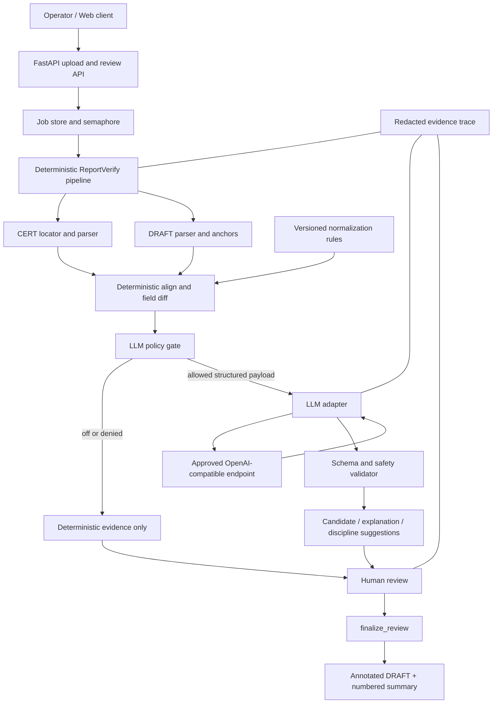

# 设计文档：报告草稿核对的可选 LLM 集成

## Overview

本功能把 CertAgent 当前的 OpenAI-compatible LLM 使用能力以**可选、受策略约束、可回退**的方式适配到独立的“报告草稿准确性核对（ReportVerify）”项目。目标不是让 LLM 重新判断 CERT 与 DRAFT 是否一致，而是在确定性核对已经产生候选之后，提供三类非权威建议：残余行的候选匹配、对既有差异的可解释说明、未来分专业路由的候选专业。

CERT 仍是应然基准，DRAFT 仍是实然对象；`normalize_for_compare`、字段映射、`compare_blocks`、差异类型、批注锚点、`finalize_review` 和下载门禁仍由确定性代码与人工确认控制。LLM 的任何超时、网络错误、输出不合法、策略拒绝或配置错误都必须降级为确定性结果，并在 trace、任务状态和人工界面中显式可见。

本设计只创建 spec 文档，不修改业务代码、CertAgent 生产代码、部署配置或任何真实凭据。

## Design Goals and Non-Goals

### Goals

- 完全复用 CertAgent 当前已批准的模型、Base URL、`/chat/completions` endpoint、请求/响应契约、Bearer/user-key 鉴权方式和流式优先约定；ReportVerify 不引入第二套 provider 协议。
- 通过本机受控环境变量或受控 secret 注入复用 CertAgent 的同一组凭据。可以提供变量映射和本地部署迁移步骤，但任何真实 key 只存在受控运行环境，不进入代码、文档、fixture、日志、trace、工作日志或回复。
- 保留 CertAgent 的 SSE/非流式兼容、当前 JSON repair、逐次超时、重试、总时限熔断和失败回退思想，并适配 ReportVerify 的 `asyncio.to_thread` 后台任务；repair 后仍必须经过 ReportVerify 本地 Schema 和安全校验。
- 在已确认的服务器策略 `REPORT_VERIFY_LLM_ALLOW_ORIGINAL_TEXT=true` 下，允许发送经过字段白名单和脱敏策略处理的 CERT/DRAFT 字段原文；原始文件、文件路径、图片、二进制、工具调用和外部 URL 访问始终不允许外发。
- 支持创建任务时选择服务器允许的 `llm_mode`，但任务级选择只控制候选/解释能力，不能覆盖 provider、模型、凭据、host allowlist、TLS 或图片硬拒绝策略。
- 为每次调用保存可审计但脱敏的证据：功能、规则版本、模型标识、重试/超时/回退状态、输入摘要哈希和输出校验结果。
- 兼容现有 FastAPI 上传、任务查询、差异查询、人工确认和最终下载接口；新增字段必须向后兼容。
- 把人工确认边界写入数据模型：AI 建议不等于差异结论、不等于专业路由、不等于审批。

### Non-goals

- 不用 LLM 替换 `field_map.normalize_for_compare` 或扩展其忽略范围。
- 不让 LLM 改写 `VerifyResult.diffs`、交换 `cert_value`/`draft_value` 方向或直接决定 `accept/ignore/modify`。
- 不自动分专业、不自动审批、不接入 KOA/Tims。
- 不支持图片理解或任何图片外发；图片外发必须在组装 payload 和发起网络请求前硬拒绝。
- 不重新选择外部 provider、模型、Base URL、endpoint、请求/响应格式或鉴权方式；这些均以 CertAgent 当前配置和契约为准。

## Current Baseline and Reuse Boundary

### ReportVerify 当前流程

当前 `run_verification` 是同步确定性流水线：

```text
ensure_docx
  -> locate_cert_blocks(CERT 超集)
  -> parse_draft_blocks(DRAFT，并保存 Anchor)
  -> load_rules(normalized-v2)
  -> compare_blocks(CERT 基准 / DRAFT 被核对对象)
  -> write_comments(批注写入 DRAFT)
  -> validate_outputs + write_summary
  -> verification.json
  -> FastAPI 后台任务进入 review
  -> /decisions 全量人工确认
  -> finalize_review 生成最终双文档
  -> /result/{draft|summary} 仅在 done 可下载
```

`VerifyDiff` 已有 `match_confidence`、`match_reason`、`match_status`、`discipline_status`、`rule_version`、`draft_anchor` 和 `row_key`，适合承载“AI 建议元数据”，但不能让这些字段绕过人工确认。

### CertAgent 可复用项与适配项

| CertAgent 当前能力 | 复用方式 | ReportVerify 适配/限制 |
|---|---|---|
| `SUGGESTER_MODE=mock|llm` | 保留同类模式思想 | 使用 `REPORT_VERIFY_LLM_MODE=off|candidate|explain|candidate_explain`，默认 `off`；不复用 CertAgent 全局进程状态 |
| `LLM_BASE_URL`、`LLM_API_KEY`、`LLM_MODEL` | 使用 CertAgent 当前同值配置 | 通过本机受控环境变量或受控 secret 注入映射到 `REPORT_VERIFY_LLM_BASE_URL`、`REPORT_VERIFY_LLM_API_KEY`、`REPORT_VERIFY_LLM_MODEL`；不在仓库复制或保存值 |
| `LLM_USER_KEY` query 参数 | 完全复用内网网关鉴权约定 | 映射到 `REPORT_VERIFY_LLM_USER_KEY`；只允许已确认的 query 参数方式，日志永不记录值 |
| `POST {base}/chat/completions` | 完全复用 endpoint、Bearer header、JSON body 和 model 选择 | 仅发送结构化字段 payload；不得发送文档文件、图片、原始路径或二进制；任务级请求不能改 endpoint |
| `temperature=0`、`stream=true` | 完全复用 CertAgent 当前请求参数 | 优先 SSE；provider 不支持 stream 时按 CertAgent 当前受控非流式 JSON 兼容方式处理，不能由任务请求放宽 |
| `_read_sse_stream` | 完全复用 `data:`、`[DONE]`、`choices[0].delta.content` 和非流式 `message.content` 提取兼容策略 | 仍增加 ReportVerify 的单行/累计响应上限、空响应和 deadline 检查；不记录原始响应正文 |
| `_repair_json` + `_parse_changes` | 遵从 CertAgent 当前去围栏/提取 JSON 的 repair 和解析兼容方式 | repair 只解决语法容错；之后必须执行 ReportVerify 严格 Schema、字段类型、索引、同表/同组、一对一、枚举、置信度和人工门禁校验 |
| `LLM_TIMEOUT`、`LLM_MAX_RETRY` | 复用逐次请求 timeout 和最多 `max_retry + 1` 次尝试 | 增加总时限、指数/固定退避上限、状态可观测；不对总时限熔断重试 |
| `_LLM_TOTAL_TIMEOUT=120s` + `_LLMAbort` | 复用“单次调用墙钟总时限熔断” | 设计为环境变量可配置并设置安全上限；报告服务再加 provider 级冷却熔断，避免并发任务持续打坏端点 |
| 异常回退 `MockSuggester` | 复用“失败不影响主流程” | 回退到确定性匹配/规则解释器；绝不生成“无差异”或伪造成功建议 |
| `propose_fuzzy_pairs` | 复用其“只提名、不决策、同表同组、一对一、阈值过滤”原则 | ReportVerify 候选必须保留 CERT/DRAFT 引用、字段原文（在服务器策略允许时）和证据摘要，并保持 `pending`；接受候选后仍由确定性重比对，不能直接变成最终 diff |
| `summarize_changes`/`summarize_from_groups` | 只复用“基于输入差异归纳”的角色和结构化输出思想 | 本项目初始只支持差异解释；不得把 CertAgent 的五类业务模板、照片占位或清单变更语义直接套到报告核对结论 |
| `memory`/反馈提示 | 复用“记忆只作提示”原则 | 使用 ReportVerify 自己的 `feedback.jsonl`；历史反馈不能改写归一化规则或自动确认本次差异 |
| `trace.dump` | 复用阶段证据思路 | 必须脱敏：只存 request/response 摘要哈希、Schema 校验结果、状态和原因，不存 API key、user key、原文 prompt、完整响应或图片 |

CertAgent 当前的“总超时/熔断”是单次流式读取的墙钟中止，不是完整的跨任务断路器；本功能把它作为单请求熔断复用，并新增可选的 provider 冷却状态，这是必要的服务层适配，不改变确定性核对语义。

本 feature 已确认使用 CertAgent 当前模型和同一组 Base URL、endpoint、请求/响应契约及鉴权凭据。ReportVerify 只在启动/部署时通过受控注入完成变量映射，不复制凭据值；任务请求不能选择其他 provider 或传入新的 key。

## Architecture

### High-Level Design

### Architecture Overview



### Trust boundaries

1. **Document boundary**：上传的 CERT/DRAFT 文本、表格值和图片均是不可信输入；文档内容不能改变系统 prompt、工具、规则或 endpoint。
2. **Outbound boundary**：只有 policy gate 明确允许的结构化字段才可离开本机；在已确认的服务器策略 `REPORT_VERIFY_LLM_ALLOW_ORIGINAL_TEXT=true` 下可包含 CERT/DRAFT 字段原文，但原始文件、文件路径、二进制、图片、嵌入对象、外部 URL 访问和工具调用始终禁止外发；图片能力固定为 `false`，任何图片请求必须硬拒绝。
3. **Provider boundary**：API key、user key 和完整请求不得进入日志、`verification.json`、`job.json`、反馈记忆或下载文档。
4. **Decision boundary**：LLM 输出在 validator 后仍只是建议；确定性规则、差异集和 `finalize_review` 是权威层。
5. **Approval boundary**：`discipline_pending` 与 `llm_discipline_candidate` 只用于展示/候选，不创建审批任务、不触发通知、不允许下载绕过全量人工确认。

### Data flow and allowed capabilities

| 能力 | 输入 | 输出 | 是否影响确定性结果 | 是否需要人工确认 |
|---|---|---|---|---|
| 候选匹配 | 确定性引擎未配对的 CERT/DRAFT 行的最小字段、表/分组上下文 | 一对一候选 pair、置信度、理由 | 否；仅生成 `llm_candidates` | 是；接受后重跑确定性比对 |
| 差异解释 | 已生成的 `VerifyDiff` 及引用的 CERT/DRAFT 值 | 不改变值的短解释、关注点、建议动作 | 否 | 是；仅作为 review note 预览 |
| 专业候选 | 差异的 block/field/item 元数据和已发布规则摘要 | 候选专业、理由、置信度 | 否；不写 `discipline` 最终值 | 是；当前保持 `discipline_pending` |
| 归一化/最终差异 | 原始字段与规则 | 不允许 LLM 参与 | 是，由确定性代码完成 | 现有确认流程 |
| 审批/下载 | 人工 verdict 和服务器状态 | 最终文档 | 不允许 LLM 参与 | 现有全量确认门禁 |

LLM 输入采用字段白名单。候选匹配和差异解释可在服务器策略 `REPORT_VERIFY_LLM_ALLOW_ORIGINAL_TEXT=true` 下发送被允许的 `cert_value`/`draft_value` 字段原文，并同时附带 `block_type/table_idx/group/item_name/model` 等最小结构化上下文；脱敏 profile、字段/字符/行数上限和 capability 白名单仍由服务器控制。原始文件、文件路径、二进制、图片和嵌入对象永不进入 payload；任何图片输入或图片外发请求在 policy gate 处硬拒绝且不得触发网络调用。文档字段中的指令、URL、代码块和“忽略系统要求”等内容一律只作为数据值。

## Components and Interfaces

### `report_verify.llm.config`（新增设计）

从环境变量构造不可变运行配置。API key 只保存在进程内存中的 provider client，不出现在配置序列化结果。

```python
from dataclasses import dataclass
from typing import Literal

LLMMode = Literal["off", "candidate", "explain", "candidate_explain"]

@dataclass(frozen=True)
class LLMSettings:
    mode: LLMMode
    base_url: str                # same value as CertAgent current LLM_BASE_URL
    model: str                   # same value as CertAgent current LLM_MODEL
    api_key: str                 # injected from the same controlled secret; never serialized
    user_key: str                # same optional CertAgent gateway credential; never logged
    timeout_seconds: int
    max_retry: int
    total_timeout_seconds: int
    circuit_failure_threshold: int
    circuit_cooldown_seconds: int
    max_response_bytes: int
    allow_original_text: bool    # server policy; true is confirmed for approved modes
    allow_images: Literal[False] # fixed false; no env or job override
    allow_job_override: bool     # confirmed true for selecting an allowed mode
    allowed_job_modes: frozenset[LLMMode]
    response_schema_version: str # follows CertAgent current response format
    redaction_profile: str

    @classmethod
    def from_env(cls) -> "LLMSettings": ...

    def diagnostics(self) -> dict[str, object]:
        """Return non-secret mode/limits/provider-host metadata only."""
        ...
```

服务器策略默认保持 `mode=off`；一旦允许启用 candidate/explain，`REPORT_VERIFY_LLM_ALLOW_ORIGINAL_TEXT=true` 是已确认的字段原文策略，`allow_job_override=true` 仅允许任务选择 `allowed_job_modes` 中的 mode。`allow_images` 永远为 `false`；任何环境变量、任务字段或内部调用试图设为 true 都使策略拒绝并在发起网络请求前返回 `llm_image_externalization_rejected`。若 mode 非 `off` 但同 CertAgent 的 Base URL、model、API key 或受控 user key 注入缺失，配置状态为 `misconfigured`，任务仍走确定性流程并显示显式 LLM warning。

### `report_verify.llm.policy`

```python
@dataclass(frozen=True)
class OutboundAuthorization:
    authorized: bool
    capability: str
    reason: str
    document_text_allowed: bool
    images_allowed: Literal[False]
    redaction_profile: str


def authorize_outbound(
    settings: LLMSettings,
    *,
    capability: str,
    operator_policy: dict[str, object] | None,
) -> OutboundAuthorization: ...


def authorize_job_mode(
    settings: LLMSettings,
    requested_mode: LLMMode | None,
) -> LLMMode: ...


def build_minimal_payload(
    capability: str,
    cert_rows: list[dict[str, str]],
    draft_rows: list[dict[str, str]],
    diffs: list[dict[str, object]],
    *,
    rules_version: str,
    redaction_profile: str,
) -> dict[str, object]: ...
```

`build_minimal_payload` 只接受已经解析的结构化值和服务器策略允许的 CERT/DRAFT 字段原文，不接受文件路径、`Document` 对象、二进制、图片或未经允许的嵌入内容。`REPORT_VERIFY_LLM_ALLOW_ORIGINAL_TEXT=true` 时，原文仍必须经过 capability 字段白名单、最大行数/字符数和脱敏 profile；该值只能由服务器配置决定。任何图片字段、图片对象或要求发送图片的 capability 都直接返回 `llm_image_externalization_rejected`，不得产生网络请求。字段白名单、最大行数、最大字符数、脱敏策略和规则版本都写入 payload metadata；文档正文中的指令、URL、代码块和“忽略系统要求”等文本一律当作普通值。`authorize_job_mode` 只允许请求选择 `settings.allowed_job_modes` 中的 mode；它不能修改 provider、model、Base URL、key、host allowlist、TLS、原文策略或图片固定值。

### `report_verify.llm.client`

```python
@dataclass(frozen=True)
class LLMCallMetadata:
    provider_host: str
    model: str
    schema_version: str
    attempts: int
    elapsed_ms: int
    transport: str                 # sse | json
    status: str                     # success | timeout | circuit_open | ...
    request_sha256: str
    response_sha256: str | None
    fallback_reason: str = ""

@dataclass(frozen=True)
class LLMRawResult:
    content: str
    metadata: LLMCallMetadata

class LLMClient:
    def __init__(self, settings: LLMSettings, breaker: "CircuitBreaker") -> None: ...

    def complete_json(
        self,
        messages: list[dict[str, str]],
        *,
        schema_version: str,
        request_id: str,
    ) -> LLMRawResult:
        """Call approved provider; never return an unbounded or unvalidated body."""
        ...
```

请求约定完全适配并复用 CertAgent：`POST {base_url.rstrip('/')}/chat/completions`，使用同一 `model`、`Authorization: Bearer <in-memory key>`、已确认的 `user_key` query 参数、JSON body 字段、`temperature=0` 和 `stream=true`。ReportVerify 不接受任务级 provider、model、Base URL、key 或鉴权覆盖。不支持 SSE 时，严格按 CertAgent 当前的非流式 JSON 兼容策略读取完整 response；是否走 SSE/JSON 不是任务请求可以放宽的权限。

响应内容严格遵从 CertAgent 当前格式和解析兼容策略：SSE reader 处理 `data: {...}`、`data: [DONE]`、空行、`choices[0].delta.content`，非流式处理 `choices[0].message.content`，并先执行当前 `_repair_json`/`_parse_changes` 兼容逻辑。该兼容解析不是信任边界；解析后仍必须通过 ReportVerify 本地 capability Schema、安全校验和人工门禁。

SSE reader 必须：

- 处理 `data: {...}`、`data: [DONE]`、空行和非流式 `choices[0].message.content`；
- 只累积 `content`，忽略 reasoning/debug 字段；
- 检查单行和累计响应上限；
- 每次读取检查 deadline；达到总时限立即抛出不可重试的 `LLMTotalTimeout`；
- 不把原始响应放入异常消息或日志。

重试策略：连接错误、HTTP 429/5xx 和临时解析空响应最多重试 `max_retry` 次，退避有上限；鉴权错误、策略拒绝、Schema 失败和总时限熔断不重试。每次调用总墙钟时间包括所有重试与退避。

### `report_verify.llm.schemas`

CertAgent 的 JSON 修复逻辑可以作为语法容错，但不能作为信任边界。建议使用项目已批准的 JSON Schema/Pydantic 版本，对每个 capability 定义独立 schema：

```python
@dataclass(frozen=True)
class CandidatePair:
    cert_index: int
    draft_index: int
    confidence: float
    reason: str

@dataclass(frozen=True)
class CandidateResponse:
    schema_version: str
    pairs: list[CandidatePair]

@dataclass(frozen=True)
class ExplanationResponse:
    schema_version: str
    explanations: list[dict[str, str]]  # diff_key, explanation, risk

@dataclass(frozen=True)
class DisciplineCandidate:
    diff_key: str
    discipline: str
    confidence: float
    reason: str

@dataclass(frozen=True)
class DisciplineResponse:
    schema_version: str
    candidates: list[DisciplineCandidate]
```

`validate_response` 必须拒绝：非法 JSON、错误 schema version、未知必需字段、索引越界、重复 cert/draft index、confidence 不在 `[0, 1]`、跨表/跨组 pair、未知 diff key、非允许专业、过长 reason、或输出中出现会被解释成自动 verdict 的字段。只有通过结构校验和本地候选护栏的结果才能落入 `llm_candidates`；schema 失败必须回退，不可猜测修复业务值。

### `report_verify.llm.orchestrator`

```python
@dataclass(frozen=True)
class LLMSuggestionSet:
    status: str  # disabled | skipped_policy | success | fallback | invalid
    candidates: list[dict[str, object]]
    explanations: list[dict[str, object]]
    discipline_candidates: list[dict[str, object]]
    metadata: dict[str, object]


def generate_suggestions(
    result: "VerifyResult",
    *,
    settings: LLMSettings,
    trace_id: str,
    operator_policy: dict[str, object] | None = None,
) -> LLMSuggestionSet: ...
```

编排顺序固定为：

1. 先完成 `compare_blocks` 和 `same_value`；
2. 只对确定性引擎剩余的候选池调用 `candidate`；
3. 只对已存在的 `VerifyDiff` 调用 `explain`；
4. 专业候选只读取差异元数据和已发布规则摘要，当前写入 `discipline_status="discipline_pending"`；
5. 对候选 pair 只生成待确认证据，不改变 `result.diffs`；若未来人工接受，必须以明确的候选 key 重跑确定性对齐和字段核对；
6. 将 `suggestions.json`/trace 元数据写入任务目录，保留原始 `verification.json` 的确定性证据不被覆盖；
7. 任何失败都调用确定性回退器，并把失败原因分类记录。

## Low-Level Design: Configuration and Runtime Model

### Proposed environment variables

所有变量只定义配置接口，不提供值，不复制任何真实密钥：

| 变量 | 默认/约束 | 用途 |
|---|---|---|
| `REPORT_VERIFY_LLM_MODE` | `off` | `off`、`candidate`、`explain`、`candidate_explain` |
| `REPORT_VERIFY_LLM_BASE_URL` | 与 CertAgent 当前 `LLM_BASE_URL` 同值，由受控环境/secret 注入 | 完全复用 CertAgent endpoint base；必须通过同等 host/HTTPS 校验，任务请求不可覆盖 |
| `REPORT_VERIFY_LLM_MODEL` | 与 CertAgent 当前 `LLM_MODEL` 同值，由受控环境/secret 注入 | 完全复用 CertAgent 当前模型；任务请求不可选择其他模型 |
| `REPORT_VERIFY_LLM_API_KEY` | 由 CertAgent 当前 `LLM_API_KEY` 的同一受控 secret 注入；不提供文档默认值 | 只读入内存并用于同一 Bearer 鉴权；绝不复制到仓库、日志或 trace |
| `REPORT_VERIFY_LLM_USER_KEY` | 与 CertAgent 当前 `LLM_USER_KEY` 使用同一受控注入；可为空但不得改鉴权语义 | 完全复用当前 query 鉴权约定；值只在内存中使用，日志不记录 |
| `REPORT_VERIFY_LLM_TIMEOUT` | `60` 秒，上限由管理员定 | 单次 HTTP/read timeout |
| `REPORT_VERIFY_LLM_MAX_RETRY` | `2`，上限由管理员定 | 瞬时错误的额外重试次数 |
| `REPORT_VERIFY_LLM_TOTAL_TIMEOUT` | `120` 秒 | 单次调用（含重试/退避）总墙钟熔断 |
| `REPORT_VERIFY_LLM_CIRCUIT_FAILURE_THRESHOLD` | `3` | provider 连续失败后打开断路器 |
| `REPORT_VERIFY_LLM_CIRCUIT_COOLDOWN` | `60` 秒 | 冷却后允许一次探测请求 |
| `REPORT_VERIFY_LLM_MAX_RESPONSE_BYTES` | 受限正整数 | 防止响应膨胀 |
| `REPORT_VERIFY_LLM_ALLOW_ORIGINAL_TEXT` | `true`（已确认的服务器策略；服务器可仅通过配置关闭，不可由任务开启） | 允许 capability 白名单内的 CERT/DRAFT 字段原文进入 payload；不改变文件/路径/图片/工具调用禁令 |
| `REPORT_VERIFY_LLM_ALLOW_IMAGES` | `false`（固定安全常量；任何 `true` 配置均拒绝，且无任务级覆盖） | 图片能力不支持；发现图片字段、图片对象或图片请求时在网络调用前硬拒绝 |
| `REPORT_VERIFY_LLM_REDACTION_PROFILE` | `standard` | 脱敏级别；不得由上传者请求放宽 |
| `REPORT_VERIFY_LLM_ALLOW_JOB_OVERRIDE` | `true`（已确认；仅允许选择服务器 allowlist 中的 mode） | 允许创建任务时传 `llm_mode`；不得覆盖 provider、model、Base URL、key、host/TLS allowlist、原文策略或图片固定值 |
| `REPORT_VERIFY_LLM_ALLOWED_MODES` | `off,candidate,explain,candidate_explain` 的服务器 allowlist，可按部署收窄 | `POST /api/jobs` 的 `llm_mode` 只能从此集合选择；未知或未允许 mode 明确返回 400 |
| `REPORT_VERIFY_LLM_RESPONSE_SCHEMA` | 与 CertAgent 当前响应格式和解析兼容策略同源；版本只作本地校验标识 | 先执行 CertAgent 当前 JSON/SSE/repair 解析，再执行 ReportVerify 本地 Schema 和安全校验 |
| `REPORT_VERIFY_LLM_ALLOWED_HOSTS` | 与 CertAgent 当前批准的 provider host/网络策略一致的受控清单 | 防止配置误指向未批准 endpoint；任务请求不能覆盖 |
| `REPORT_VERIFY_LLM_ALLOW_PLAINTEXT` | `false`；遵从 CertAgent 当前 TLS/网络策略，默认禁止非 TLS | 任务请求不能放宽 TLS 或 host allowlist |

`REPORT_VERIFY_API_KEY` 仍只保护现有 Web API，不与 LLM provider key 混用。

### CertAgent 凭据注入与变量映射

部署适配只定义名称映射，不复制任何凭据值：

| CertAgent 当前受控配置名 | ReportVerify 运行时配置名 | 约束 |
|---|---|---|
| `LLM_BASE_URL` | `REPORT_VERIFY_LLM_BASE_URL` | 读取同一受控环境/secret 注入，值必须经过同一 host/TLS 策略 |
| `LLM_MODEL` | `REPORT_VERIFY_LLM_MODEL` | 读取同一模型标识，任务不能覆盖 |
| `LLM_API_KEY` | `REPORT_VERIFY_LLM_API_KEY` | 使用同一受控 secret；只注入进程内存，不在迁移文件或日志中落盘 |
| `LLM_USER_KEY` | `REPORT_VERIFY_LLM_USER_KEY` | 按 CertAgent 当前 query 鉴权方式注入；没有值时保持同样的缺省语义 |

本地部署可以增加一个凭据迁移/注入检查任务，验证映射存在、权限正确且诊断输出已脱敏；该任务只能读取受控运行环境，不能打印、复制、回显或持久化 key。ReportVerify 不接受请求体、fixture、设计文档或任务参数提供 provider 凭据。

`job.json` 的 `summary()` 只返回 `llm_mode`、`llm_status`、`llm_warning_count` 等非敏感信息。

## Data Models

### Job and trace additions

现有 `Job.status` 语义保持不变：`queued → running → review → done`，确定性流水线失败仍为 `failed`，人工确认失败仍回到 `review`。新增字段为可选、向后兼容：

```python
@dataclass
class LLMJobState:
    mode: str = "off"
    status: str = "disabled"  # disabled|skipped_policy|running|success|fallback|invalid|misconfigured
    capabilities: list[str] = field(default_factory=list)
    suggestion_count: int = 0
    warning_count: int = 0
    last_error_code: str = ""
    trace_path: str = ""

@dataclass
class LLMReviewCandidate:
    candidate_key: str
    capability: str
    cert_ref: dict[str, object]
    draft_ref: dict[str, object]
    confidence: float
    reason: str
    status: str = "pending"  # pending|accepted_for_recheck|rejected|expired
    source: str = "llm"
    policy_version: str = ""
    schema_version: str = ""
```

`verification.json` 中增加只读的 `llm` 节点和脱敏调用记录；原有 `result.diffs`、`rules`、`outputs` 字段保持原结构。建议新增：

```python
{
    "llm": {
        "mode": "off|candidate|...",
        "status": "disabled|success|fallback|...",
        "policy_version": "...",
        "schema_version": "...",
        "capabilities": ["candidate"],
        "calls": [
            {
                "capability": "candidate",
                "provider_host": "approved.example",
                "model": "configured-model",
                "attempts": 1,
                "elapsed_ms": 0,
                "transport": "sse",
                "status": "success",
                "request_sha256": "...",
                "response_sha256": "...",
                "fallback_reason": ""
            }
        ],
        "candidates": [],
        "warnings": []
    }
}
```

trace 中不得包含 `api_key`、`user_key`、完整 Authorization header、完整 prompt、完整 response、原始图片、未授权原文或可逆密钥编码。`provider_host` 仅在允许审计时保存 host，不保存完整 URL query。

## Low-Level Design

### FastAPI interface compatibility

现有接口保持可用：

- `POST /api/jobs`：仍接收 `cert` 与 `draft` 文件；请求可以带可选 `llm_mode`（`off`、`candidate`、`explain` 或 `candidate_explain`），由 `authorize_job_mode` 校验是否在服务器 `REPORT_VERIFY_LLM_ALLOWED_MODES` allowlist 中。`REPORT_VERIFY_LLM_ALLOW_JOB_OVERRIDE=true` 时允许创建任务选择 mode；缺省沿用服务器 mode。未知或未允许 mode 返回明确 400。任务级字段只能选择能力 mode，不能覆盖模型、Base URL、endpoint、API key、user key、host/TLS allowlist、`REPORT_VERIFY_LLM_ALLOW_ORIGINAL_TEXT` 或固定为 false 的图片策略，也不能通过请求体单独开启任何外发能力。
- `GET /api/jobs`、`GET /api/jobs/{job_id}`：原字段不删除；追加 `llm_mode`、`llm_status`、`llm_suggestion_count`、`llm_warning_count`。
- `GET /api/jobs/{job_id}/diffs`：原差异分页结构不变；每项可追加 `llm_explanation`、`llm_candidate_keys`、`llm_review_status`，默认空值。
- `GET /api/jobs/{job_id}/row-diffs`：原 row diff 与人工决策结构不变；可追加候选引用，不能改变 `diff_keys` 的权威含义。
- `POST /api/jobs/{job_id}/decisions`：原 `decisions` 仍必须覆盖所有确定性 diff key，现有 verdict 校验不变；可选 `candidate_decisions` 仅用于显式接受/拒绝 AI 候选。接受候选不得直接完成任务，必须触发确定性重核对或进入 `accepted_for_recheck`。
- `GET /api/jobs/{job_id}/memory`：仍只返回反馈记忆提示，不返回 provider secret；LLM 建议不能写入历史反馈，直到人工确认产生正式 verdict。
- `GET /api/jobs/{job_id}/result/{kind}`：仍只在 `status=done` 时可下载；LLM `success`、`fallback` 或 `skipped_policy` 都不能绕过全量人工确认。
- 建议新增只读 `GET /api/jobs/{job_id}/llm-evidence`，返回脱敏状态、候选、解释及调用摘要，不返回 prompt/response 原文；若不新增 endpoint，则通过现有 job trace 受控展示。

后台任务中，`run_verification` 完成后才执行 LLM orchestrator；LLM 调用必须继续放在 `asyncio.to_thread` 中，使用独立的 provider semaphore/断路器，不能阻塞 FastAPI event loop。LLM 失败时 job 仍进入 `review`，并在 `stage` 或 `llm_status` 中显示回退原因；只有确定性 pipeline 失败才进入整体 `failed`。

### Candidate matching algorithm

候选匹配必须遵守 CertAgent 的安全护栏，并叠加 ReportVerify 的 CERT/DRAFT 语义：

```python
def propose_candidates(
    cert_rows: list[dict[str, str]],
    draft_rows: list[dict[str, str]],
    *,
    threshold: float,
    same_table_only: bool = True,
    same_group_only: bool = True,
) -> list[LLMReviewCandidate]:
    """
    Preconditions:
      - 输入只包含确定性 matcher 未消费的行；
      - 每行有稳定的 CERT/DRAFT ref；
      - 原始规则版本已记录；
      - policy gate 已授权 candidate 能力。
    Postconditions:
      - 结果只包含 confidence >= threshold 的候选；
      - 每个 CERT/DRAFT 行最多出现一次；
      - 不跨物理表或不兼容分组；
      - 不改变 result.diffs 或 normalize_for_compare 的结果；
      - 每项状态为 pending，必须人工决定。
    """
    ...
```

本地 validator 必须再次检查同表、同分组、索引范围和一对一约束，即使模型 prompt 已要求这些限制。候选被人工接受后，系统只能把它作为确定性重核对的输入；重核对仍逐字段调用 `same_value`，并保留真实 `cert_value`、`draft_value`。LLM 给出的 reason 不能成为差异字段值。

### Explanation and discipline algorithm

解释输入必须来自已落盘的 diff，不允许模型自行读取文件；输出只能引用给定值和位置，不得补造 CERT 数据。解释失败时 UI 显示“无 AI 解释，依据确定性证据”。

专业候选只在已发布的路由规则摘要上工作；若无规则或规则版本未确认，直接 `skipped_policy`，所有 `VerifyDiff.discipline_status` 继续为 `discipline_pending`。LLM 的 `discipline` 字符串不能写入最终 `discipline` 字段，除非未来单独实现人工确认和规则发布流程。

## Error Handling

| 错误代码 | 触发 | 对外任务行为 | 回退 |
|---|---|---|---|
| `llm_disabled` | mode=off | `review`，无警告或显示 disabled | 仅确定性证据 |
| `llm_policy_denied` | 未授权 capability、字段、endpoint、任务 mode 或外发策略不满足 | `review`，显式 warning | 跳过该能力 |
| `llm_task_mode_not_allowed` | 请求的 `llm_mode` 不在服务器 allowlist，或尝试覆盖 provider/key/host/TLS/图片策略 | 创建任务返回 400，不发 provider 请求 | 使用服务器默认 mode 或要求客户端修正 |
| `llm_image_externalization_rejected` | payload、附件、字段对象或任务请求包含图片/图片外发意图；图片策略固定 false | `review`，显式 warning；调用前硬拒绝 | 仅确定性证据，不发送图片或任何替代图片内容 |
| `llm_misconfigured` | 缺同 CertAgent 注入的 Base URL/model/key、映射不完整、Schema 标识不兼容或安全配置无效 | `review`，`llm_status=misconfigured` | 规则解释/无建议，不尝试读取请求体中的凭据 |
| `llm_auth_failed` | 401/403 | `review`，显式 warning；不重试 | 回退 |
| `llm_rate_limited` | 429 | 重试至上限后 `fallback` | 回退并打开 provider 熔断计数 |
| `llm_http_error` | 5xx/连接错误 | 有限重试后 `fallback` | 回退 |
| `llm_attempt_timeout` | 单次 timeout | 有限重试 | 回退 |
| `llm_total_timeout` | 总墙钟 deadline 到期 | 立即熔断，不重试 | 回退 |
| `llm_circuit_open` | provider 冷却中 | 不发请求 | 回退 |
| `llm_response_empty` | SSE/JSON 无 content | 有限重试（若非策略错误） | 回退 |
| `llm_schema_invalid` | JSON 修复/严格校验失败 | 不采纳输出 | 回退 |
| `llm_safety_rejected` | 跨表、重复索引、未知 key、越权专业等 | 不采纳输出 | 回退 |
| `llm_trace_redaction_failed` | 无法确保日志/trace 脱敏 | 禁止外发或丢弃调用结果 | 仅确定性证据 |

“回退”必须保留原始确定性差异，不得清空差异列表、生成“无差异”或把 LLM 失败当成业务失败。若 LLM 解释失败，现有 `review_note` 不被覆盖；若候选失败，原有 `missing_in_draft`/`extra_in_draft` 证据仍在。

## Security, Privacy and Operational Controls

### Data minimization and authorization

- 在已确认的服务器策略 `REPORT_VERIFY_LLM_ALLOW_ORIGINAL_TEXT=true` 下，候选匹配和差异解释可发送 capability 白名单内的 CERT/DRAFT 字段原文；只发送必要结构化上下文、限定行数/字符数并执行脱敏。原始文件、文件路径、文件名业务信息、二进制、批注内容、图片和嵌入对象不外发。
- `allow_original_text`、每种 capability 的字段白名单和最大数据量必须是服务器配置，不能由普通上传请求放宽；任务级 `llm_mode` 只选择能力，不改变该服务器策略。
- 图片能力固定为 `false`，不接受单独授权、不读取任务级图片开关；发现图片字段、图片对象或图片发送意图时，在 payload 组装/网络请求前硬拒绝并保留 warning。
- 脱敏在组装 payload 前完成，且 trace 保存脱敏 profile 与结果摘要，不保存可逆映射表。
- 外发前检查与 CertAgent 一致的 endpoint host、TLS、证书策略和租户边界；禁止把真实 key 写入 `.env.example`、设计文档、测试 fixture、任务请求或提交记录。

### Logging and evidence

日志允许记录：job id、trace id、capability、状态码类别、attempts、elapsed、provider host、model、schema version、request/response hash、fallback code。日志禁止记录：Authorization、query user key、prompt、response 原文、CERT/DRAFT 字段原文、图片、Cookie 和完整 URL query。即使服务器策略允许字段原文进入 provider payload，trace/job/review 也只保存脱敏摘要和哈希。

输入证据仍以本地 `verification.json` 为权威，LLM 证据为附属节点；反馈记忆只在人工完成 verdict 后写入，且不把 provider 内容写入 `feedback.jsonl`。trace 目录权限、保留期和删除策略必须由部署管理员确认。

### Prompt/output safety

- 使用固定系统/用户模板，文档字段作为 JSON 数据插入，不执行字段中的指令。
- 禁止 tool/function calling、URL 访问、代码执行和模型自行读取附件。
- 对输出做 JSON Schema、长度、枚举、引用存在性、同表同组、一对一和置信度校验。
- 任何模型输出都标记 `source=llm`、`status=pending`，UI 明确显示“AI 建议，不是最终结论”。

## Correctness Properties

### Property 1: 确定性规则不受影响
对任意相同 CERT/DRAFT、规则版本和确定性配置，LLM 开关为 `off` 与 LLM 失败回退时，`result.diffs`、`cert_value`、`draft_value`、`rule_version` 和现有输出证据相同。

**Validates: Requirements 2.2, 2.3, 6.3**

### Property 2: 归一化权威性
LLM 不调用、不替代、不能修改 `normalize_for_compare`；仅已配置规则决定格式差异是否一致。

**Validates: Requirements 2.2**

### Property 3: 候选守恒
每个 LLM candidate 至多引用一个 CERT 行和一个 DRAFT 行，且只在同表/兼容分组内；无候选会删除或吞并原始行。

**Validates: Requirements 3.1, 5.4**

### Property 4: 人工门禁
任何 LLM 状态（success/fallback/disabled）都不能使 `download_ready=true`；只有现有 `finalize_review` 接受全部确定性 diff 才能下载。

**Validates: Requirements 3.4, 6.4**

### Property 5: 方向不变
所有解释与建议引用中，CERT 仍是应然值、DRAFT 仍是实然值；模型不能交换两者。

**Validates: Requirements 2.2**

### Property 6: 失败显式化
每个 provider failure、policy denial、schema failure 和 fallback 都有状态码/trace warning；不得静默转成“无差异”。

**Validates: Requirements 2.3, 5.2, 7.1, 7.2**

### Property 7: 证据可回放
每次调用可由 job/trace id、规则版本、policy 版本、schema 版本、请求摘要哈希和 provider 元数据回放判断，但无需保存秘密或完整原文。

**Validates: Requirements 1.3, 7.1, 7.4**

### Property 8: 人工路由边界
LLM 专业候选不会直接填充最终 discipline、改变 `discipline_status` 或触发审批。

**Validates: Requirements 3.3**

### Property 9: 接口兼容
关闭 LLM 时现有 FastAPI endpoint 的必需请求字段、状态转移、差异 key 和下载门禁保持不变；新增字段只增不删。

**Validates: Requirements 6.1, 6.2, 6.4**

## Testing Strategy

### Unit tests

- 逐环境变量构造 `LLMSettings`：mode、同 CertAgent 变量映射、缺配置、上限、host allowlist、secret diagnostics 脱敏、`allow_images` 固定 false 和任务 allowlist。
- SSE reader：`data:`、`[DONE]`、空行、非流式 JSON、reasoning content、非法行、响应大小和总 deadline；断言解析行为与 CertAgent 当前兼容策略一致。
- retry：连接/429/5xx 可有限重试；401、Schema failure、policy denial 和 total timeout 不重试。
- JSON repair + strict schema：遵从 CertAgent 当前围栏/前后杂文 repair；越界、重复、跨组、未知 key、非法 confidence 和自动 verdict 字段被 ReportVerify 拒绝。
- payload policy：在 `REPORT_VERIFY_LLM_ALLOW_ORIGINAL_TEXT=true` 下允许白名单内 CERT/DRAFT 字段原文；始终拒绝文件、路径、二进制、图片、嵌入对象和工具调用，并记录规则版本与字段白名单。
- candidate validator：一对一、同表同组、阈值、原始 diff 不变。
- fallback：mock/确定性解释器输出不清空差异，不产生自动 verdict。
- circuit breaker：连续失败打开、冷却期阻断、探测成功关闭；并发下状态安全。

### Integration/API tests

- `REPORT_VERIFY_LLM_MODE=off` 跑现有 `unittest discover -s tests -v`，确认旧接口和结果完全兼容。
- provider stub 测试与 CertAgent 完全一致的 model、Base URL、`/chat/completions` headers/body/query、SSE/JSON response 和 repair 行为；凭据只使用空值/占位符或 stub token，不读取或调用真实 provider。
- 后台任务测试 LLM 调用在 `to_thread`，状态依次为 `running → review`，LLM fallback 不使任务变 `failed`。
- `POST /api/jobs` 测试 `llm_mode` 的服务器 allowlist：允许的 mode 生效，未知/未允许 mode 返回 400；请求不能修改 provider/key/host/TLS、原文策略或图片策略。
- `/api/jobs/{id}`、`/diffs`、`/row-diffs` 对新增字段向后兼容；未知候选 key/非法 candidate decision 返回 400。
- LLM 成功、超时、Schema invalid、policy denied 后，`download_result` 在人工确认前均返回 409。
- 全量确认后生成的最终文档与关闭 LLM 时相同；解释/候选只改变附属 evidence，不改变确定性输出。

### Security/privacy tests

- 静态扫描日志、trace、异常和 `job.json` 不含 API key、user key、Authorization 或 prompt/response 原文；允许 provider payload 使用字段原文的策略不改变本地证据脱敏要求。
- 上传包含提示注入文本时，模板、规则、endpoint 和工具调用不变。
- 任何图片字段、图片对象或图片外发意图都在网络请求前被固定 `false` policy 硬拒绝，并保留明确 warning；任务 `llm_mode` 不能绕过。
- provider host 不在 allowlist、非 TLS、证书策略失败或凭据映射不完整时不发请求。

### Acceptance evidence

使用本地假 provider 和脱敏/占位 fixture 生成：确定性 `verification.json`、允许字段原文策略下的 LLM 附属 evidence、图片硬拒绝 evidence、fallback evidence、人工确认后的 `review.json`。不使用真实 CERT/DRAFT 原文、真实图片、真实密钥或真实 provider。

## Performance and Dependency Considerations

- 保持现有 `max_concurrent_jobs`；新增独立 `LLM` semaphore，默认小于或等于后台任务并发数，避免 provider 被突发任务压垮。
- 候选 payload 只取残余池并设置行数/字符数上限；解释可分页或批量，但每次调用必须受总时限和响应上限保护。
- LLM 调用失败不能阻塞确定性结果；等待人工期间不重复调用，除非显式重跑。
- 优先复用现有 HTTP client 约定；若引入 `requests`/JSON Schema/Pydantic 等依赖，必须在实施阶段使用固定版本、审查供应链并更新 requirements，而不是直接复制 CertAgent 的部署依赖。
- 不要求运行期访问 CertAgent 目录；适配层复制“接口契约/安全原则”，而非导入 CertAgent 生产模块，保持独立项目边界。

## Confirmed Decisions and Remaining Implementation Checks

以下事项已由用户确认，实施不再将其作为产品/接入待决策项：

1. **模型与 endpoint**：完全复用 CertAgent 当前模型、Base URL 和 `/chat/completions` endpoint。
2. **请求/响应/鉴权契约**：完全复用 CertAgent 当前请求 body、`temperature=0`、SSE/JSON 传输、Bearer/user-key 鉴权、响应提取和 JSON repair 兼容策略；ReportVerify 只在其后增加本地 Schema、安全校验和人工门禁。
3. **凭据**：复用 CertAgent 当前同一组凭据，通过本机受控环境变量或受控 secret 注入并按映射提供给 ReportVerify；任何真实值不进入仓库或文档。
4. **字段原文**：服务器策略 `REPORT_VERIFY_LLM_ALLOW_ORIGINAL_TEXT=true` 时，允许 capability 白名单内的 CERT/DRAFT 字段原文发送，并继续执行脱敏、字段/尺寸上限和审计摘要。
5. **图片策略**：暂不支持图片；`allow_images` 固定为 `false`，不接受任何授权或任务级覆盖，发现图片外发意图必须在网络请求前硬拒绝。
6. **任务级 mode**：创建任务可以传 `llm_mode` 并选择服务器 allowlist 中的 mode；任务级选择不能覆盖 provider、模型、endpoint、凭据、host/TLS allowlist、原文策略或图片策略。

以下是实施/部署验证项，不改变上述已确认契约，也不应通过请求体解决：

1. **凭据注入运维实现**：确定本机受控环境或 secret store 的权限、轮换、撤销和健康检查方式；实现只验证映射和脱敏，不打印或持久化 key。
2. **服务器 mode allowlist 与阈值**：由部署配置确定允许开放的 mode 子集、候选置信度阈值、人工角色和 `accepted_for_recheck` 触发方式；未配置时保持 `off` 或拒绝该 mode。
3. **日志与保留**：确定 trace/evidence 的保存期限、访问角色、删除方式、provider 审计要求和跨境/跨租户限制；不保存 secret、prompt/response 原文或图片。
4. **专业规则**：确定专业候选可读取的已发布规则版本；在规则和人工流程实现前保持 `discipline_pending`，不实现自动路由。

## Implementation Boundary

本 feature spec 的实施只允许新增/适配 LLM 配置、policy、client、schema、orchestrator、任务状态和测试；禁止修改 CertAgent 生产代码，禁止改变 ReportVerify 确定性规则、差异算法、批注对象、人工确认和下载门禁的既有语义。所有 provider 联调使用本地 stub 或管理员明确批准的受控环境，不能把真实 key 写入代码、文档、fixture、日志、trace、工作日志或回复。
