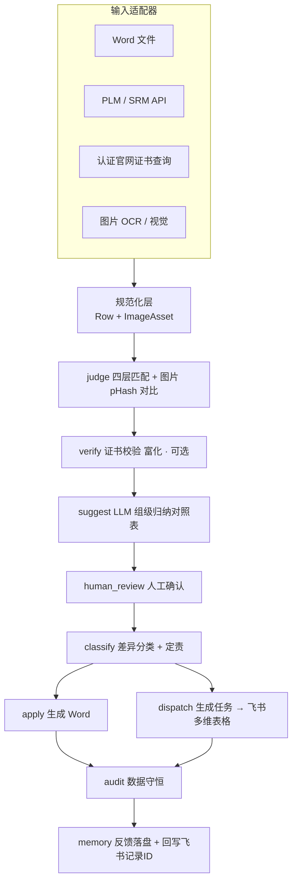

# 认证智能体 · 扩展设计：OCR 图片对比 + 网络信息库输入 + 飞书差异分类派单

> 文档版本：v1.0（2026-08-12）
> 定位：在现有"变更-开发 关键件清单整合"MVP 基础上，向输入端、输出端扩展三大能力，并把"差异确认"升级为"差异分类 → 任务分配 → 飞书协作闭环"。
> 前置阅读：`工作日志.md`（三.1~三.47）、现有 `compare_core` 8 节点流水线。

---

## 0. 设计总原则（贯穿全文，不可突破）

现有系统的三条铁律在所有扩展中继续成立：

1. **确定性优先**：差异的"判去留"永远由确定性代码完成（可复现、可审计、零幻觉）。OCR、网络查询、LLM 分类都只做**提名 / 富化 / 建议**，绝不参与判定。
2. **人在环拍板**：所有低置信结果（OCR 文本、LLM 分类、责任人指派）必须经人工确认后才生效。
3. **数据守恒**：每条输入行、每张图片资产、每条差异都必须有归属，审计三层校验照常；扩展只增加校验对象，不削弱守恒。

**架构手法**：现有 8 节点核心**一行不改**，所有新能力都作为**适配器**挂在 `parse`（输入边界）和 `apply`（输出边界）两端，另加两个可选节点（`verify` 网络富化、`classify`/`dispatch` 分类派单）。

---

## 1. 总体架构（扩展后）



新增流水线节点序列：
```
parse → judge → [verify] → suggest → human_review → classify → apply
                                                        └→ dispatch → audit → memory
```

---

## 2. 扩展一：OCR 图片识别与对比

### 2.1 要解决的业务点
- PRD 对照表含"增加整机外观 / 内部结构 / 主板 / 电源板照片"，当前只能标 `[外部输入]` 占位，无法自动推导（见工作日志三.12）。
- 证书扫描件、铭牌、结构照片里的文字信息无法进入比对。
- 图像版 / 扫描版清单（python-docx 无法解析）需要视觉路线兜底（承接 `parser test0727` 视觉路线）。

### 2.2 新增模块 `compare_core/vision/`

| 文件 | 职责 |
|---|---|
| `ocr.py` | `OcrProvider` 协议 + 实现：PaddleOCR（本地/离线/合规，首选）、Qwen-VL（复杂版面/内网 API）、云 OCR API。输出 `{text, boxes, confidence}` |
| `image_diff.py` | 图片对比三法：① **pHash / dHash** 判"是否同一张 / 改动程度"（确定性）；② OCR 文本 diff（铭牌/证书文字，复用 `normalize` + 词级 diff）；③ **SSIM** 定位变化区域并框出 |
| （models 扩展） | 新增 `ImageAsset`（path / phash / ocr_text / category / 来源 / 版本） |

### 2.3 接入点
- **并行输入通道**：证书图 / 铭牌 / 结构照片 → OCR → `ImageAsset`；铭牌类 OCR 文本可映射进 `Row` 参与关键件比对。
- **对照表照片类落地**：旧版本 vs 新版本照片按 `category` 配对，pHash 差异超阈值 → 标"照片已更新"，真正填上原来 `[外部输入]` 的坑。
- **审计延伸**：每张输入图片是否有归属（守恒扩展到图片资产）。

### 2.4 确定性边界
- pHash / SSIM 是确定性数值 → **可参与**判定（可复现、可审计）。
- OCR 文本是模型输出 → **不参与**判定，低置信必须人工确认。

### 2.5 工具
PaddleOCR（本地首选）、Qwen-VL（内网 API 备选）、opencv-python + imagehash（pHash/SSIM）、Pillow、PyMuPDF（PDF 转图，承接 parser test0727）。

---

## 3. 扩展二：输入直连网络信息库

### 3.1 要解决的业务点
- PRD 数据依赖 PLM 结构化认证信息；IT 依赖 PLM / TIMS / SRM / KOA + 认证官网。
- 当前 B 侧要人工从 PLM 导 Word；证书号有效性靠人工核；供方认证信息靠人工要。

### 3.2 新增模块 `compare_core/sources/`（输入连接器）

| 文件 | 职责 |
|---|---|
| `base.py` | `SourceConnector` 协议：`fetch_rows(config) -> list[Row]` |
| `plm_connector.py` | 从 PLM API 直拉关键件清单（替代手工导 Word 的 B 侧） |
| `cert_registry_connector.py` | 按证书号查认证官网（CQC / CCC 等）→ 证书状态 / 有效期 / 明细 |
| `srm_connector.py` | 供方认证信息（对应 PRD"接收供方更新认证信息"） |

### 3.3 接入点
- `parse_node` 增加输入分派：不只 `parse_document(file)`，也可 `connector.fetch_rows(source_config)`，返回同一 `Row` 模型，下游完全不变。
- 新增可选 **`verify_node`**（judge 之后）：按证书号查官网，给行附加 `cert_status`（有效 / 过期 / 查无）+ 有效期 → 直接服务 PRD"证书有效期预警""报告草稿准确性核对"。

### 3.4 安全与可靠性（遵守系统安全规范）
- 凭据放 env / 密钥库，不入代码。
- 网络结果视为**不可信外部数据**：缓存 + 离线兜底 + 限流 + 超时重试。
- 网络查询只做**富化 / 校验提示**，不改变确定性 diff 结果。
- 非功能约束（≤50s）：网络调用异步 + 缓存，放在守恒核心之外。

### 3.5 工具
httpx / requests、内网 PLM/SRM SDK 或 REST、本地缓存（sqlite/json）、tenacity（重试）。

---

## 4. 扩展三：差异分类 + 飞书多维表格任务分配

### 4.1 要解决的业务点
差异确认后，需要按**专业分工**（结构 / 电源 / 电路 / 光学 / 声学 + 认定 / 认证）把变更派给对应工程师处理，并跟踪状态直至闭环。对应 PRD"审批认证申请""确认报告草稿准确性"环节。

### 4.2 差异分类体系（多维标签）

每条差异（或每个关键件组）打四个维度：

| 维度 | 取值 | 判定方式 |
|---|---|---|
| **变更类型** | 新增件 / 内容变更 / 型号扩充 / 供应商变更 / 证书更新 / 照片变更 / 旧件保留 | 由 DiffType + changed_fields **确定性**推导 |
| **责任专业** | 结构 / 电源 / 电路 / 光学 / 声学 / 认证 / 安规 | 关键件名称+分组 → 专业**规则映射**，歧义交 LLM 提名 |
| **处理动作** | 补充资料 / 送检 / 更新证书 / 供应商确认 / 拍照留档 / 仅知会 | 变更类型 × 专业 规则 + LLM |
| **优先级** | 高（认证标准升版 / 证书过期）/ 中 / 低 | 规则 |

**责任专业规则映射**（`rules/data/discipline_map.yaml`，可配）：

| 关键件 / 分组关键词 | 专业 |
|---|---|
| 后壳材料、外壳、结构件、绝缘垫片、器具耦合器、电线组件 | 结构 / 安规 |
| 机内电源单元、电源板、变压器 | 电源 |
| 主板、PCB、内部布线、天线、调谐、网卡 | 电路 |
| 显示屏、LCD、背光 | 光学 |
| 扬声器 | 声学 |
| 认证标准 / 证书号 变更 | 认证工程师 |

### 4.3 分类方法（守铁律）
1. **规则优先**：变更类型由 DiffType 直接推导（确定性）；专业由名称映射表命中（确定性）。
2. **LLM 提名**：映射表未命中的关键件，LLM 建议专业（只提名，带置信度）。
3. **人工确认**：分类结果在确认页 / 飞书里可改，责任人可人工指派。

### 4.4 任务聚合策略（避免任务爆炸）
按 **关键件组 × 责任专业**聚合（复用现有 43 组抽象）：
- 一个关键件组的多行差异 → 合并成**一条任务**（如"机内电源单元换型 53772-A→55431-F，新增 9 类子件"）。
- 同专业多个小变更可再聚（可配）。
- 结果：约 5～15 条任务，符合"按事分工"。

### 4.5 任务数据模型

```python
class Task(BaseModel):
    task_id: str            # 稳定哈希键（幂等 upsert / 去重）
    标题: str
    变更类型: str
    责任专业: str
    负责人: str | None      # 命中责任人映射则填，否则留空由管理者指派
    处理动作: str
    优先级: str
    差异摘要: str           # 组级归纳（复用 LLM summarize_from_groups）
    关联关键件: list[str]
    关联证书号: list[str]
    来源: str               # 变更单号 / 清单版本
    状态: str = "待处理"     # 待处理 / 处理中 / 已完成 / 已确认
    diff_keys: list[str]    # 回溯到具体物理行（守恒）
    feishu_record_id: str | None
```

### 4.6 飞书多维表格任务表

字段（Bitable）：

| 字段 | 类型 | 说明 |
|---|---|---|
| 任务标题 | 文本 | |
| 变更类型 / 责任专业 / 处理动作 / 优先级 | 单选 | 做筛选看板 |
| 负责人 | **人员字段** | 飞书 @人，触发待办 / 通知 |
| 差异摘要 | 多行文本 | 组级归纳 |
| 关联关键件 / 证书号 | 文本 | |
| 附件 | 附件 | 挂 OCR 照片对比图 |
| 状态 | 单选 | 待处理→处理中→已完成→已确认 |
| 截止日期 | 日期 | 可选 |

**派单逻辑**：
- 责任人映射表（`discipline_owner.yaml` 或飞书维护"专业-责任人"表）→ 命中自动填负责人，飞书自动推送待办。
- 未命中 → 负责人留空，管理者在看板手动指派。
- **幂等 upsert**：按 `task_id` 去重，重跑不重复建；状态变化增量更新。
- **回写**：飞书 `record_id` 存回 memory，支持状态回读（做"认证指标看板"数据源）。

**状态闭环**：责任人在飞书更新状态 →（可选）webhook 回调本系统 → 全部"已确认"才算变更闭环。

### 4.7 工具
飞书 OpenAPI（Bitable records batch、人员字段、附件上传、可选 webhook）；tenant_access_token 缓存刷新；分类复用现有规则库 + DeepSeek。

---

## 5. 涉及模块汇总

| 新增 / 改动 | 内容 |
|---|---|
| `compare_core/vision/`（新） | `ocr.py`、`image_diff.py` |
| `compare_core/sources/`（新） | `base.py`、`plm_connector.py`、`cert_registry_connector.py`、`srm_connector.py` |
| `compare_core/classify/`（新） | `classifier.py`、`discipline_map.yaml`、`action_rules.yaml` |
| `compare_core/exporters/`（新） | `feishu_bitable.py`（记录写入 + 任务派单 + upsert + 回写） |
| `compare_core/models.py` | 新增 `ImageAsset`、`Task`、`DiffCategory`；`Row` 加 `cert_status` |
| `compare_core/nodes.py` | 新增 `verify_node` / `classify_node` / `dispatch_node` |
| `webapi` + `frontend` | 输入源选择、分类/责任人展示可改、"派单到飞书"按钮、状态回读、图片上传对比视图 |

---

## 6. 原则守护矩阵

| 环节 | 确定性？ | 谁拍板 |
|---|---|---|
| 图片 pHash / SSIM 相似 | 是 | — |
| OCR 文本 | 否（模型） | 人工确认 |
| 网络证书查询 | 否（富化） | 人工参考 |
| PLM 直拉数据 | 是（换输入源） | — |
| 变更类型判定 | 是（DiffType 推导） | — |
| 专业映射（命中规则） | 是 | — |
| 专业 / 动作（LLM 提名） | 否 | 人工确认 |
| 责任人指派 | 半自动 | 管理者可改 |
| 飞书输出 / 任务状态 | 否 | 责任人更新 |

分类 / OCR / 网络出错，顶多派错人或多一次核对，人可改；**不影响 diff 判定与数据守恒**。任务的 `diff_keys` 保留到物理行，审计可校验"每条差异都进了某个任务"。

---

## 7. 建议分期（按独立性与风险排序）

| 期 | 内容 | 依赖 | 风险 |
|---|---|---|---|
| **P1** | 飞书输出 + 差异分类派单（规则分类先行，假数据本地跑通） | 飞书 app 凭据 + 表结构 | 低（最独立） |
| **P2** | 网络输入：先 `cert_registry_connector` 做证书号校验（服务有效期预警），再 PLM 直连 | 内网 / 官网 API | 中（接口未知） |
| **P3** | OCR 图片对比：本地 PaddleOCR + pHash 做照片对比，填对照表照片类的坑 | 视觉工具 / 合规授权 | 高（最复杂） |

---

## 8. 待业务 / IT 确认

**飞书派单**
- 任务表字段定义、人员字段是否用飞书通讯录、是否触发待办 / 群通知。
- 专业-责任人映射来源（配置表 / 飞书维护 / PLM 组织架构）。
- 任务聚合粒度：按关键件组 / 按专业 / 一件一任务。
- 状态闭环用 webhook 回写还是定时轮询。
- 优先级规则（哪些变更算"高"）。

**网络输入**
- PLM / SRM / 认证官网是否有开放 API、鉴权方式、字段 schema。
- 证书查询频率限制与缓存策略。

**OCR 图片**
- 是否允许把文档 / 照片发外部视觉 API（合规）。
- 整机外观 / 内部结构照片从哪个系统取。
- 图片对比金标准（多相似算"同一张"、多大差异算"已更新"）。

---

> 本设计遵循现有系统"确定性判定 + 人在环 + 数据守恒"三铁律，所有扩展均为边界适配器，核心 8 节点不改。落地顺序建议 P1 → P2 → P3。
